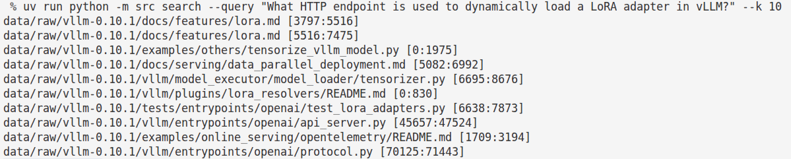

*This project has been created as part of the 42 curriculum by stmaire.*

<div align="center">
<br>
  
  <br>
</div>

# RAG Against The Machine


## 🔵 Description

### ✳️ Goal
The objective of this project is to build a Retrieval-Augmented Generation system that answers questions about a codebase. The system is designed to ingest the provided vLLM repository, retrieve the most relevant snippets for a given question, generate a grounded answer using the Qwen/Qwen3-0.6B model, and measure the retrieval quality using the recall@k metric.

### ✳️ Overview
Language models only know what they were trained on, and retraining them to add knowledge is slow and costly. Instead of putting knowledge directly into the model, this system allows it to pull information from an external source at answer time.

The RAG pipeline functions through four main stages:
 - Indexing: The data is organised so it can be searched.
 - Retrieving: A question is matched against the index to pull the most relevant snippets.
 - Augmenting: Those snippets are filtered and placed into the model's context window.
 - Generating: The context is read to produce the answer.

## 🔵 Instructions

### ✳️ Prerequisites
*   Python 3.10 or later.
*   The `uv` project and package manager.
*   Ollama installed and running locally with the `Qwen/Qwen3-0.6B` model pulled.
*   Sufficient free disk space for the deep-learning stack and model weights.

### ✳️ Installation
To install the project dependencies using `uv`, run the following command at the root of the repository:
```bash
make install
```
### ✳️ Execution

**1. Execution via Makefile**

You can run the CLI commands using the Makefile. By default, running `make run` triggers the `index` command.

To execute other commands, you can override the ARGS variable. For example:


```bash
make run ARGS="search --query 'What HTTP endpoint is used to dynamically load a LoRA adapter in vLLM?' --k 5"
```

Note: You can use any of the commands and options listed in the Manual Execution section below by passing them to the ARGS variable.


**2. Manual Execution via uv**

Alternatively, you can interact directly with the Command-Line Interface (CLI) built with Python Fire. Every command is invoked through the Python module:

```bash
uv run python -m src <command> [options]
```

**Available CLI Commands:**

*Note: The commands below use default settings. These are used when the command is run without options. Each option (max_chunk_size, k, folder and file names) can be modified based on the location of your data.*


- **index**: Ingest the raw data and build the processed index. Options include --max_chunk_size (defaults to 2000) and --with_embeddings for vector indexing (bonus). Without options, the command uses the default settings below.

```bash
uv run python -m src index --max_chunk_size 2000
```

- **search**: Return the top-k sources for a single query. Requires --query. Default setting: k = 10. This parameter can be modified. Can be run with --hybrid to combine lexical and semantic search (bonus).

```bash
uv run python -m src search --query "What HTTP endpoint is used to dynamically load a LoRA adapter in vLLM?" --k 10
```

- **search_dataset**: Run search over a whole dataset and write a JSON file. Default settings: see the command below. This parameters can be modified. Can be run with --hybrid.

```bash
uv run python -m src answer_dataset \
  --student_search_results_path data/output/search_results/UnansweredQuestions/dataset_docs_public.json \
  --save_directory data/output/search_results_and_answer/UnansweredQuestions
```

- **answer**: Answer a single query using the retrieved context. Requires --query Default setting: k = 10. This parameter can be modified.. Can be run with --hybrid.

```bash
uv run python -m src answer --query "What hardware platforms does vLLM support?" --k 5
```

- **answer_dataset**: Generate answers for a dataset, producing a JSON file. Default settings: see the command below. This parameters can be modified.

```bash
uv run python -m src answer_dataset \
  --student_search_results_path data/output/search_results/UnansweredQuestions/dataset_docs_public.json \
  --save_directory data/output/search_results_and_answer
```

- **evaluate**: Report your own recall@k against a ground-truth dataset, for your own testing. Default settings: see the command below. This parameters can be modified.

```bash
uv run python -m src evaluate \
  --student_search_results_path data/output/search_results/UnansweredQuestions/dataset_docs_public.json \
  --dataset_path data/datasets/AnsweredQuestions/dataset_docs_public.json
```

**3. Evaluation & Full Pipeline**

To run the complete RAG pipeline and evaluate your retrieval performance, execute the following commands sequentially:

- **Index the corpus**: Build the processed index from the raw source documents.

```bash
uv run python -m src index --max_chunk_size 2000
```

- **Run search over a dataset**: Generate search results and save them (ensure --save_directory is scoped appropriately to avoid overwriting files).

```bash
uv run python -m src search_dataset \
  --dataset_path data/datasets/UnansweredQuestions/dataset_docs_public.json \
  --k 10 \
  --save_directory data/output/search_results/UnansweredQuestions
```

- **Score with the moulinette**: Evaluate your student search results against the ground-truth dataset.

```bash
./moulinette evaluate_student_search_results \
  data/output/search_results/UnansweredQuestions/dataset_docs_public.json \
  data/datasets/AnsweredQuestions/dataset_docs_public.json \
  --k 10 --max_context_length 2000
```

**4. Code Quality & Linting**

In accordance with the 42 curriculum standards, the project adheres to strict coding rules using flake8 and mypy for PEP 8 compliance and type safety.

```bash
# Standard linting
make lint

# Strict type checking
make lint-strict
```

**5. Debugging**

Run with Python debugger (pdb):

```bash
make debug
```

**6. Cleanup**

Remove cache and temporary files:

```bash
make clean
```

To perform a full cleanup that also removes the generated index, the vector database, and the output files:

```bash
make fclean
```

## 🔵 System architecture
### ✳️ RAG Pipeline components

The RAG system is organized into modular Python packages inside the src/ directory, ensuring a clear separation of concerns:

- **Corpus Compiler** (src/indexing/ingestion.py): Discovers and compiles raw text, Python, and Markdown files from data/raw/ into a unified list of files to process.

- **Document Chunker** (src/indexing/chunker.py): Implements specialized splitting strategies (TxtChunker, PyChunker, MdChunker) to segment documents into manageable chunks while preserving code structures.

- **Indexer & Tokenizer** (src/indexing/indexer.py & src/core/tokenizer.py): Cleans text, removes stop words and short tokens, computes term frequencies (TF) and document frequencies (DF), and optionally builds semantic vector embeddings using ChromaDB.

- **Retrievers** (src/retrieval/):
    - **BM25Retriever** : Performs lexical keyword-based search using BM25 scoring.
    - **HybridRetriever**: Combines lexical BM25 results with ChromaDB semantic search using Reciprocal Rank Fusion (RRF).

- **Answerer & Generator** (src/generation/): Interacts locally with the Ollama LLM API to synthesize context-aware answers based on the top-retrieved text chunks.

- **CLI & Evaluator** (src/core/cli.py & src/dataset/evaluator.py): Provides a user-friendly Command-Line Interface built with Python Fire and handles automated dataset evaluation (Recall@k).

### ✳️ Interactions between components

The data flows sequentially through the pipeline from raw files to final evaluation or answer generation:

- **Ingestion & Indexing**: The DocIndexer calls the CorpusVllmCompiler to fetch source files. Each file is passed to its respective chunker to generate metadata (MinimalSource objects with character start/end indexes).

- **Tokenization & Storage**: The Tokenizer cleans the chunk texts, and the indexer stores the computed statistics, term frequencies, and token counts into a structured JSON index (data/processed/index.json). If requested, semantic vectors are stored in ChromaDB.

- **Retrieval Process**: When a user enters a query via the CLI, the chosen retriever (BM25Retriever or HybridRetriever) queries the processed index and/or vector database to score and rank the most relevant text chunks.

- **Answering & Evaluation**: For generation, the retrieved chunks are sent alongside the query to the Answerer to produce a final response. For evaluation, the retrieved chunk boundaries are compared against the ground-truth dataset to compute the Recall@k score.

## 🔵 Chunking strategy
To prevent documents from being split arbitrarily (which could cut code functions or paragraphs in half), our chunking strategy adapts specifically to the file format. We implement a flexible abstract base class (Chunker) with three specialized sub-components located in src/indexing/chunker.py:

- **Plain Text Chunker** (TxtChunker): Splits standard text files smoothly, favoring natural breaks around empty lines once a minimum fill threshold is reached.

- **Python Chunker** (PyChunker): Analyzes the structure of Python code by tracking indentation, decorators, and definitions (def, class, async def). It prevents cutting right in the middle of methods or logic blocks, ensuring chunks remain semantically meaningful.

- **Markdown Chunker** (MdChunker): Parses Markdown files by respecting header boundaries (#, ##) and code blocks (```), ensuring sections and code snippets stay intact.

Each chunk is carefully bounded by character start and end indices (MinimalSource), allowing our system to retrieve exact text segments without losing context.

## 🔵 Retrieval method

Our system implements a dual retrieval approach, combining lexical keyword matching with semantic vector search to ensure high accuracy and robustness:

- **BM25 Lexical Retrieval (BM25Retriever)**: Built as a powerful statistical improvement over traditional TF-IDF (Term Frequency-Inverse Document Frequency), the Okapi BM25 ranking function incorporates document length normalization and term frequency saturation. Instead of letting raw term counts dominate the score, BM25 factors in:

    - **Term Frequency (TF)**: How often a query term appears in a specific chunk.
    - **Inverse Document Frequency (IDF)**: How rare or common a term is across the entire corpus (giving higher weight to rare, informative words).
    - **Document Length Normalization**: Preventing longer chunks from being unfairly penalized or favored just because they contain more words.

    This method searches our precomputed term and document frequencies (index.json). It excels at exact keyword matching, finding specific function names, class definitions, or technical terms directly referenced in the user's query.

- **Hybrid Retrieval (HybridRetriever)**: To capture deeper semantic meaning (handling synonyms, conceptual phrasing, or indirect queries), we also integrate ChromaDB vector search using pre-trained sentence embeddings (all-MiniLM-L6-v2).

- **Reciprocal Rank Fusion (RRF)**: When hybrid search is enabled, the results from BM25 and ChromaDB are fused together using the RRF algorithm. This normalizes and combines the ranks from both retrieval methods without needing complex score calibration, producing a final, highly robust top-$k$ ranking of the most relevant code chunks.

## 🔵 Performance analysis

To evaluate the effectiveness of our retrieval pipeline, we measure the Recall@k metric against the ground-truth datasets provided by the school (AnsweredQuestions and UnansweredQuestions).

Recall@k calculates the proportion of relevant chunks successfully retrieved within the top-$k$ results.

**Summary of Results**:

 - **Documentation Dataset** (dataset_docs_public.json — 100 queries)
    - Recall@1: 65.0%
    - Recall@3: 82.0%
    - Recall@5: 87.0%
    - Recall@10: 92.0%

- **Code Dataset** (dataset_code_public.json — 99 queries)
    - Recall@1: 45.5%
    - Recall@3: 77.8%
    - Recall@5: 82.8%
    - Recall@10: 85.9%

**Performance Insights**:

- **High Precision on Documentation**: The system achieves a 92% Recall@10 on documentation files, showing that exact keyword matching work very well on natural text and structured guides.

- **Challenges with Source Code**: The code dataset yields slightly lower scores (e.g., 45.5% Recall@1 vs 65.0% for docs). This is primarily because source code contains dense syntax, shared identifiers, and symbols across multiple files, making the exact top-1 placement more ambiguous without deep contextual parsing.

- **Robust Top-10 Coverage**: Across both datasets, expanding the window to $k=10$ consistently captures over 85% to 92% of the required ground-truth sources, providing the answerer with ample context to generate accurate responses.

- **Impact of Retrieval Strategies on Code**: Interestingly, semantic vector search (using ChromaDB embeddings) yielded lower performance on source code compared to pure lexical matching. Because code relies heavily on exact function names, syntax rules, and precise identifiers rather than natural language semantics, vector embeddings often introduced noise or semantic drift, whereas BM25 excelled at pinpointing exact keyword matches.


## 🔵 Design decisions

To build a robust, maintainable, and high-performing RAG system, several key design choices were made throughout development:

- **Implementation from Scratch without Heavy Frameworks**: Rather than relying on high-level abstraction libraries like LangChain or pre-packaged BM25 packages, we chose to implement our own document chunkers and lexical retrieval mechanisms from scratch. Building these components manually provided deep, precise control over tokenization, indexing, and ranking logic while keeping the codebase lightweight and transparent.

- **Modular Architecture**: The codebase is strictly partitioned into dedicated packages (indexing/, retrieval/, generation/, and dataset/). This separation of concerns ensures that components like chunkers or retrievers can be tested, debugged, or replaced independently without breaking the rest of the pipeline.

- **Pydantic Data Validation**: All input datasets, search results, and intermediate data structures are validated using Pydantic models. This ensures strict adherence to schemas, prevents silent data corruption, and provides clear, descriptive error messages when malformed data is encountered.

- **CLI Built with Python Fire**: Python Fire automatically map the RAGCli class methods into clean CLI commands. This keeps all arguments configurable.

- **Local LLM Integration via Ollama**: To ensure data privacy, independence from paid cloud APIs, and zero external network latency during evaluations, all generation tasks rely on a locally hosted LLM powered by Ollama.

- **Defensive Error Handling & Logging**: Every major operation is wrapped with error management (RagError hierarchy and custom decorators). This guarantees that edge cases (missing files, empty queries, invalid JSON, or $k=0$) fail gracefully with logs.

- **Interactive Terminal Display for Single Queries**: For single-query operations (search and answer), results and generated responses are printed directly to the terminal using a dedicated formatter. This avoids unnecessary file creation for ad-hoc queries and provides immediate, clean readability for the user.


## 🔵 Challenges faced

Developing a fully functional RAG pipeline presented several technical hurdles:

**Granular Code Segmentation & Context Preservation**: Splitting source code files without breaking logic blocks (like functions, classes, or indentation) was a major technical hurdle. A key challenge was **avoiding overly small chunks** that isolate lines of code and strip away vital contextual meaning. To solve this, our custom chunkers (PyChunker, MdChunker, TxtChunker) not only inspect code syntax and structure rather than relying on arbitrary character counts, but they also prepend metadata (such as the file path and the name of the active class, method, or header) to each chunk. This ensures that even segmented blocks retain enough context for the retriever and LLM to understand where the code lives and what it belongs to.

**Speeding Up Dataset Processing**:
 Running evaluations over large datasets took a long time at first. We solved this bottleneck by switching from heavy cloud-based setups (like Hugging Face) to a local Ollama instance, which made processing much faster and removed network delays.

 **Reducing LLM Hallucinations**: Making sure the generated answers stayed strictly tied to the retrieved documents was tricky. We stopped the model from making things up by setting the temperature to 0 for steady, exact answers and by carefully limiting the context window.


## 🔵 Example usage

### ✳️ with a single query

- **search**

<div align="center">
  
</div>

- **answer**

<div align="center">
  
</div>

### ✳️ with a dataset

- **output example (json file) with search_dataset command**:
<div align="center">
  
</div>

- **output example (json file) with answer_dataset command**:
<div align="center">
  
</div>

## 🔵 Resources

### ✳️ References

- **RAG**: https://iwanttolearnai.fr/rag

- **Okapi BM25 & Information Retrieval**:https://fr.wikipedia.org/wiki/Okapi_BM25

- **Vector Search & Embeddings**: https://www.lbke.fr/ressources/definition-embedding

- **Reciprocal Rank Fusion (RRF)**: https://julien-gourdon.fr/article/reciprocal-rank-fusion

- **Python Fire**: https://python-fire.readthedocs.io/en/latest/

- **Ollama**: https://ollama.com/

- **ChromaDB**: https://docs.trychroma.com/docs/overview/getting-started

### ✳️ AI Usage

Throughout this project, AI was used as a collaborative assistant for the following specific tasks:

**Concept Clarification**: Explaining technical concepts and mathematical formulations (such as Okapi BM25 ranking, TF-IDF variations, and Reciprocal Rank Fusion).

**Code Review & Debugging**: Verifying Python syntax, checking type annotations for Mypy compliance, and tracking down bugs.

**Documentation & Translation**: Assisting in phrasing, and translating README sections into clear, accessible English.

**Output & Hallucination Analysis**: Analyzing the JSON outputs generated by the LLM to inspect responses, and measure potential hallucinations against the source text.
